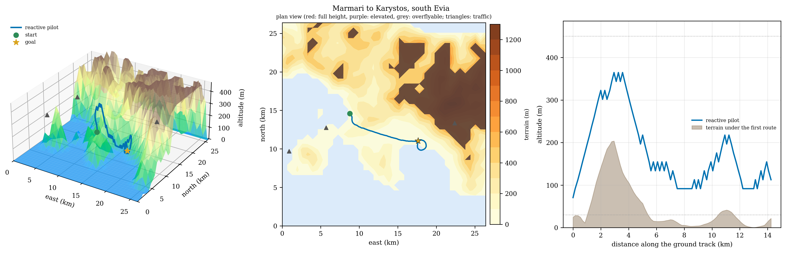
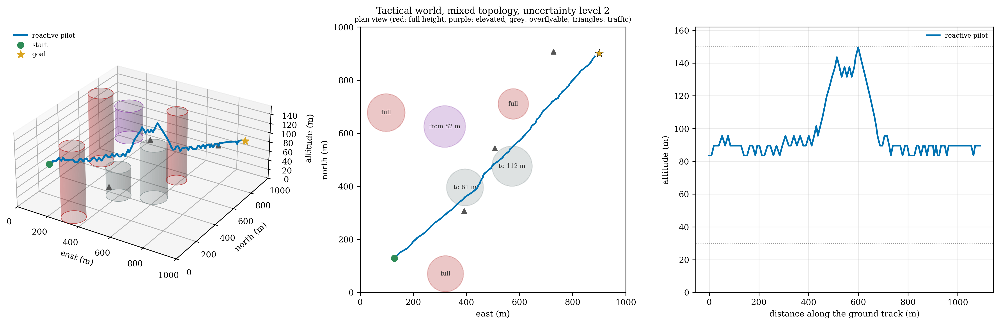
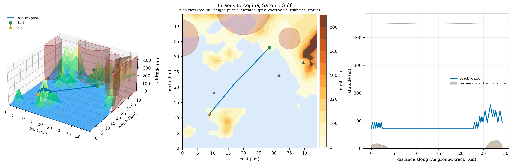

# drone_3Darea

A 3D simulation area for drone path planning under uncertainty. The package provides tactical worlds
with static volumes, terrain and moving traffic, and real low-level areas over Greece built from
airspace zones, real terrain and real wind. It is written for small unmanned aircraft: low flight
bands, multirotor power and climb models, noisy on-board sensing and in-flight uncertainty.



## What it models

| Element | Model |
|---|---|
| Vehicle | position (x, y, z), heading, airspeed 5 to 15 m/s, battery; power P = P_hover + c_p v^3 + k_climb max(vz, 0) - k_descend max(-vz, 0) |
| Actions | 27 discrete moves: heading change (3) x speed change (3) x vertical command (descend, level, climb) |
| Static obstacles | vertical cylinders with a floor and a top: towers and terrain features (can be overflown), elevated volumes (can be underflown), full-height zones (must be flown around) |
| Terrain | heightfield; synthetic hills in tactical worlds, Copernicus DEM GLO-90 in real areas |
| Moving obstacles | spheres with constant speed, a random walk in heading and in vertical speed |
| Sensing | 16 range rays (horizontal fan of 8, upper fan of 4, lower fan of 4), traffic tracks, anemometer, GPS position, barometric altitude |
| Uncertainty | zero-mean Gaussian noise on position, ranges, traffic tracks and wind measurement, gusts, GPS outage with dead reckoning; five levels (0 to 4) scale every source together |
| Estimated indices | uncertainty U (reported position accuracy, sensor noise, wind variability, traffic prediction miss) and risk R (proximity, density, closing speed, energy to go) |
| Objectives | four per-step costs: distance, energy, time, safety; collision is charged to safety and battery exhaustion to energy |

`step()` returns `(obs, reward_vec, shared_reward, done, info)`. The scalar reward for a preference
vector `w` is `shared_reward + w . reward_vec`, so the same transition serves any weighting of the
four objectives, which suits multi-objective and preference-conditioned planners.

## Install

```bash
pip install -e .
```

Requires Python 3.10 or later. The tested versions of the dependencies are listed in `requirements.txt`.

## Quick start

```python
from drone_3darea import DroneEnv3D, escalation, load_area
from drone_3darea.plot import plot_routes

# tactical world: 1000 m x 1000 m, flight band 30 to 150 m, uncertainty level 2
env = DroneEnv3D(escalation(level=2, topology="mixed"), seed=3)
obs = env.reset()
done = False
while not done:
    obs, reward_vec, shared, done, info = env.step(13)   # 13 = hold heading, speed and level
print(env.metrics.success, env.metrics.path_length, env.metrics.energy_wh)

# real area: Piraeus to Aegina over the Saronic Gulf, flight band 30 to 450 m
area = load_area("saronic")
env = area.make_env(seed=1)
obs = env.reset()
```

`python examples/demo.py` flies a simple reactive pilot in a tactical world and in the real areas and
writes the route figures to `output/`.

## Tactical worlds

Six topology families share the 1000 m world and differ in the number and kind of static obstacles,
the amount of traffic and the presence of terrain: `open`, `mixed`, `towers`, `layered`, `traffic`
and `hills`. With `random_geometry=True` (the default of `escalation`) the start, the goal and their
altitudes are drawn at every reset.



## Real areas

| Area | Mission | Data |
|---|---|---|
| `saronic` | Piraeus to Aegina, 29.4 km over water between the Athens zones and Aegina | airspace zones, terrain, wind of 30 August 2026 |
| `south_evia` | Marmari to Karystos, 9.5 km across hilly terrain | terrain, wind of 16 November 2026 |
| `thermaikos` | Thessaloniki port to Angelochori, 18.2 km across the gulf; the straight line cuts the Thessaloniki control zone | airspace zone, terrain, wind of 16 November 2026 |

Each area combines three layers, all cached in `drone_3darea/data` so that runs are offline and
reproducible:

* **Airspace zones** (`data/airspace_gr.json`): CTR, TMA, prohibited, restricted and danger areas with
  their lower and upper limits. The geometry is representative and approximate; replace it with eAIP
  or OpenAIP exports for operational use.
* **Terrain** (`data/terrain/`): Copernicus DEM GLO-90 through the Open-Meteo Elevation API, on a
  41 x 41 grid over the frame.
* **Wind** (`data/wind/`): Open-Meteo wind at 10 m and 120 m with gusts, interpolated in the plane and
  in altitude.

Lateral separations in a real area are much larger than vertical ones, so the vertical axis is
stretched internally (`cfg.z_scale`) to give the flight band the same proportion to the world as in
the tactical worlds. Energy, wind and all reported altitudes use true metres.



To add an area, add an entry with a start and a goal to `AREAS` in `drone_3darea/areas.py`; terrain
and wind are fetched and cached on first use.

## Tests

```bash
python -m pytest -q tests
```

## Citation

When this package is used, please cite:

> Charis Ntakolia, Dimitrios Lyridis. Uncertainty-Aware Adaptive Multi-Objective UAV Path Planning via
> Fuzzy Priority Adaptation and Preference-Conditioned Reinforcement Learning. In Proceedings of
> Drones 2026: Mapping the Knowledge, Barcelona, 11 November to 13 November 2026, MDPI: Basel,
> Switzerland. https://sciforum.net/paper/37525

## Data availability

No personal or participant data are included. The cached terrain and wind grids come from public
sources (Copernicus DEM GLO-90 and Open-Meteo), and the airspace zones are representative geometry.

## License

MIT

## Author

Charis Ntakolia (charis-ntak), Hellenic Air Force Academy, cntakolia@hafa.gr
